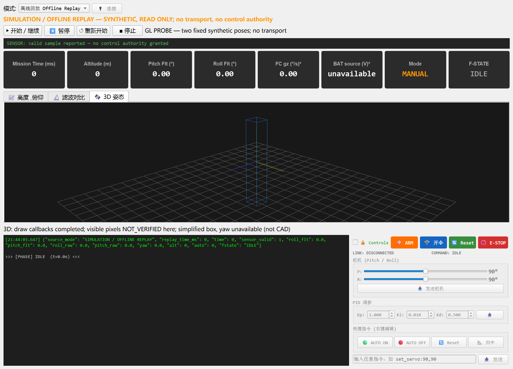
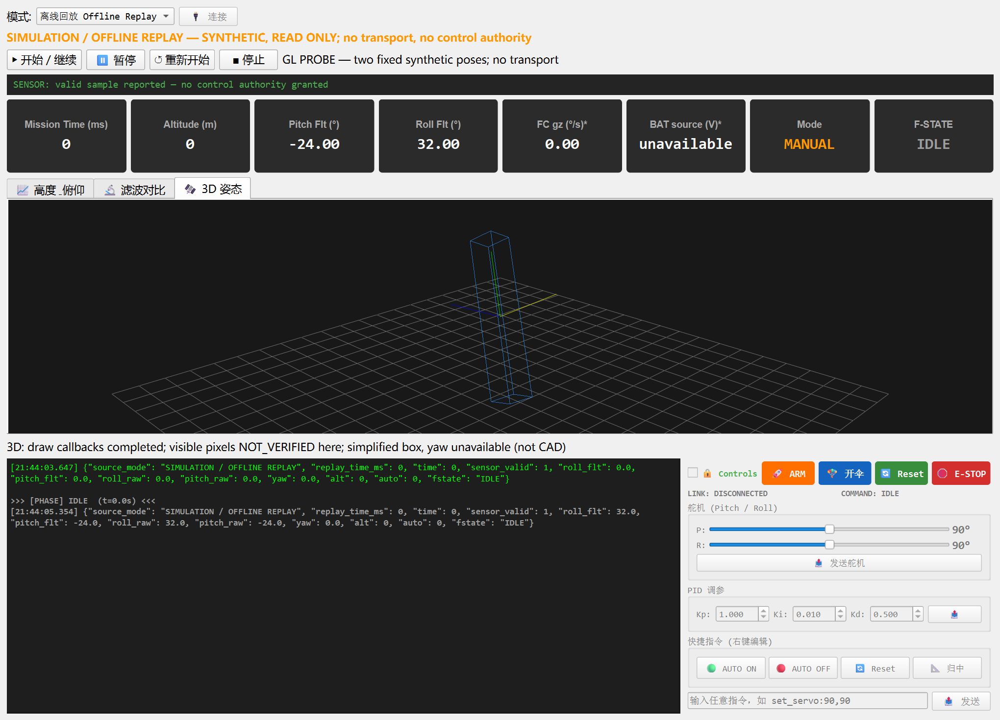

# Ground Station 3D diagnosis and bounded acceptance — 2026-10-25

## Result and authority

**SOFTWARE_OPENGL: `3D_RENDER_PASS` for the two recorded synthetic poses. Native GPU/WGL: `BLOCKED`, not repaired or qualified.** The existing Ground Station, GLViewWidget, schematic box, grid, axes and 2D QPainter fallback were retained. No CAD, firmware, control permissions, hardware connections or radio operation changed.

The source tested on Windows is `71ff3c42377912b71259a5b042bb98f791c40c1f`, based on main `26eeca3b6ed61334250c1427f07a4ef286a271c1`. Subsequent evidence/documentation commits must not be mistaken for the source SHA recorded at execution. Git status in each result includes only new evidence directories, not uncommitted production changes.

Repository cleanup and historical-branch dispositions are recorded separately in [REPOSITORY_CLOSURE_2026-10-25.md](REPOSITORY_CLOSURE_2026-10-25.md). Main's existing full gate [40193386161](https://github.com/guo6x/AI-rocket/actions/runs/40193386161) is SUCCESS; it is not the new 3D branch's CI. The final PR check is required in addition to these targeted Windows results; its exact run is retained by GitHub and the delivery receipt.

## Actual defects and minimal changes

1. **False successful-paint status:** pyqtgraph 0.14 catches child `item.paint()` exceptions inside `drawItemTree()` and prints them. The old wrapper could mark an empty/partial frame successful because `super().paintGL()` returned. An actual traversal negative test failed before the fix. Keep upstream ordering, transforms, picking and VAO behavior, propagate errors, restore the matrix stack with `finally`, and signal the existing fallback once. Initialization exceptions now follow the same sticky failure path.
2. **Software GL dispatcher mismatch:** Qt's explicit `QT_OPENGL=software` creates its context using the PySide6 bundled `opengl32sw.dll`; PyOpenGL's Win32 platform otherwise resolves system `opengl32.dll`. A valid Qt context then still produced error 1282 at `glClearColor`. A fresh PyOpenGL Win32 platform bound to the *same bundled absolute DLL*, installed before GL entry points import, resolves this on the recorded host. Changing just an already-used DLL reference is unsafe because WGL/context/extension lazy properties can remain cached. Missing/conflicting DLLs and late switching fail closed to 2D. Error checking is not disabled.
3. **Declared dependency mismatch:** the exception-aware traversal uses pyqtgraph 0.14 APIs absent in 0.13.3. Raise the declared lower bound to `>=0.14.0`, the actually tested version; do not invent a parallel legacy renderer. Later upstream API changes still require regression review.
4. **Cropped schematic:** the original distance 25 cropped the 12-arbitrary-unit box in the wide attitude tab. Display-only camera distance 60 includes every projected corner at both poses. This does not represent real rocket dimensions.
5. **Overstated pixel acceptance:** non-null contexts, completed callbacks and a changed alpha channel are not visible-geometry proof. The runtime smoke now uses RGB-only differences and reports only `PIXEL_CANDIDATE_REQUIRES_REVIEW`. The dedicated probe adds an independent geometric reference; final acceptance also requires actual screenshot review.
6. **DPI-specific test assumption:** the fallback screenshot test assumed physical pixels equal logical pixels. At Windows 150% scaling it failed; assertions now verify the same exact logical size and the corresponding device-pixel size. No visual/error assertion was removed.

Default desktop GL and requested OpenGL 2.1 Compatibility are unchanged. Software GL is opt-in, not an unannounced GPU fix.

## Environment and native-driver boundary

- Windows 11 build 26300; original `.venv`, Python 3.13.1 x64.
- PySide6/shiboken6 6.10.2; pyqtgraph 0.14.0; PyOpenGL 3.1.10; NumPy 2.4.2; pytest 9.1.1.
- Intel Arc driver `32.0.101.8331` (2026-01-29), plus GameViewer/ToDesk/Virtual Display/Parsec virtual adapters were enumerated. Enumeration does **not** identify which adapter or hook caused WGL failure.
- Qt Windows platform, logical screen 1707×1067, DPR 1.5. Software GL reports `VMware, Inc. / Gallium 0.4 on llvmpipe (LLVM 3.6, 256 bits) / 3.0 Mesa 11.2.2`.
- Bundled DLL SHA256: `d05c658cfb998ba62b0b09fe1609ba8d05fc068134c65371913d729b3e691944`.

Native desktop 2.1, a diagnostic core 3.3 profile, and disabling widget RHI did not produce a valid native frame. Recorded failures include `wglMakeCurrent ... invalid handle`, context creation failures and QRhi failures. The core-profile process did not fully terminate even though its Qt loop returned; only that verified test process was stopped. Its JSON's Qt exit code must **not** be read as a clean process exit. No further driver/profile retry was justified.

The final software run still logs WGL/RHI context-creation warnings for Qt backing-store support. They are preserved in JSON, not silenced. Its actual widget framebuffer **and original-window screenshots** nonetheless contain the correct three-dimensional scene. No driver installation, virtual-adapter changes, dependency downgrade or system DLL replacement was performed. Root cause of the native WGL handle failure remains unresolved; a separately authorized clean desktop/driver session is needed to isolate it.

## Final visible-frame evidence

Directory: `engineering/offline-evidence/system_v1/gl_production_software_20261025/`.

| Criterion | Pose A | Pose B |
| --- | --- | --- |
| Input roll / pitch / yaw, degrees | 0 / 0 / 0 | 32 / -24 / 0 |
| Actual framebuffer | 2007×477 | 2007×477 |
| Blue schematic pixels | 1,480 | 1,765 |
| All box corners inside viewport | yes | yes |
| Independent edge samples matching blue box | 108/108 | 108/108 |

RGB changed pixels: **4,367**. Reference: independent NumPy `Rz(yaw) @ Ry(pitch) @ Rx(roll)`, centered schematic corners, current camera/projection and DPR-aware framebuffer mapping. This verifies displayed mathematical transforms, not real installation axes, sensor provenance or actuator direction.

Qt exit **0**, process exit **0**, wall time **16.744 s**, diagnostic `glGetError()` **0**. Both original-window captures and both GL framebuffer captures were actually inspected by the implementing agent and a separate review agent; they show a complete nonempty box/grid/axes, not the 2D fallback, with a pose change consistent with the projection. The probe intentionally retains its conservative automatic `PIXEL_CANDIDATE_REQUIRES_REVIEW`; this report and the evidence receipt record the separate reviewed `SOFTWARE_OPENGL 3D_RENDER_PASS` decision.





These are Qt-generated screenshots, not generated UI mockups. The model remains the original arbitrary-unit box, not a qualified CAD shape.

## Tests and bounded real-application run

Targeted regression: **29 passed, 0 failed, 65.69 s, process exit 0** (18 dispatcher cases, 8 rendering/fallback cases, 3 runtime-contract cases). This is a count of distinct collected cases, not red/green attempts added together. A previous system-Python aggregate attempt was interrupted after a failure marker and prolonged lack of progress; it is explicitly **not** a passing full-suite result. Its final diagnostic trace was unavailable. The corrected tests and exact installed runtime were then checked by the bounded targeted run; the existing hosted full gate supplies aggregate verification.

Real original application: `runtime_gl_software_20261025/runtime_result.json`, **32 assertions/checkpoints**, Qt/process exit 0. It exercised no-device startup, parser → dashboard → curves → original 3D, pause/resume, invalid-sensor freeze, interruption/recovery, provenance-bearing CSV logging, restart, stop, and sender-path rejection of ARM/AUTO/servo/recovery/E-STOP/RESET in offline mode. These are software checks including screenshot saves, **not 32 new unit tests**.

The optional final soak was only **9.069 s / 69 synthetic samples**, labelled `SHORT_OBSERVATION`. No memory-series sample was reached and no leak-freedom, frame-rate or buffer-saturation claim follows from it. Existing bounded-buffer tests are reused. No new two-hour run was started; the historical interrupted run is not promoted to completed endurance evidence. Runtime overall status remains `PARTIALLY_VERIFIED` because automatic pixel detection is not final independent acceptance and hardware/native rendering remain out of scope.

Hashes and actual commands: [native_3d_acceptance_20261025.json](../engineering/offline-evidence/system_v1/native_3d_acceptance_20261025.json). Original failed diagnostic outputs are retained under the distinct `gl_native_*`, `gl_software_20261025` and `gl_software_matched_20261025` directories; those pre-final experiments have their own working-tree source hashes and are not the clean production-bootstrap acceptance.

## Reproduction without devices

From the existing project and environment (no installation/copy required):

```powershell
# Normal launcher: existing desktop default; existing 2D fallback on failure.
.\.venv\Scripts\python.exe ground_station/main.py

# Explicit software-OpenGL workaround; select Offline Replay in the original UI.
$env:QT_OPENGL = 'software'
.\.venv\Scripts\python.exe ground_station/main.py

# Device/socket-denied deterministic proof; choose a NEW output name.
.\.venv\Scripts\python.exe scripts/ground_station_gl_probe.py --software-dispatch --output engineering/offline-evidence/system_v1/gl_new_review
.\.venv\Scripts\python.exe scripts/system_v1_runtime.py --output engineering/offline-evidence/system_v1/runtime_new_review --soak-minutes 0.15
Remove-Item Env:QT_OPENGL
```

Do not reuse populated output directories or interpret selecting software GL as enabling hardware control. For automated headless unit tests, use `QT_QPA_PLATFORM=offscreen`; it does not establish Windows GPU rendering. Runtime tests use deny-all external I/O boundaries; normal UI command permissions are unchanged.

## Remaining issues and disposition

| Item | Status / next bounded action |
| --- | --- |
| Original 3D through explicit Windows software GL | `PASS` for recorded geometry/poses; reviewable branch evidence, not main until merged |
| Native GPU/WGL and Qt backing-store warnings | `BLOCKED`; retain issue #26 and 2D fallback, do not call the native driver repaired |
| General desktop endurance / leak freedom | `NOT_EVALUATED`; no requirement for another two-hour run; investigate longer only after a concrete symptom |
| Renderer compatibility beyond tested versions/host | `NOT_EVALUATED`; run exact-source regression before upgrading private pyqtgraph APIs |
| CAD / physical coordinates, real telemetry identity, LoRa or WiFi hardware, actuation and flight qualification | Unchanged `BLOCKED` / `NOT_EVALUATED`; software rendering cannot supply physical evidence |

Keep the renderer PR Draft for independent final review rather than silently merging the unresolved native-driver issue. Issue #23 and #26 stay open. CAD #22 remains separate; obsolete #21 was already closed and replaced by merged #29, not reopened here.
